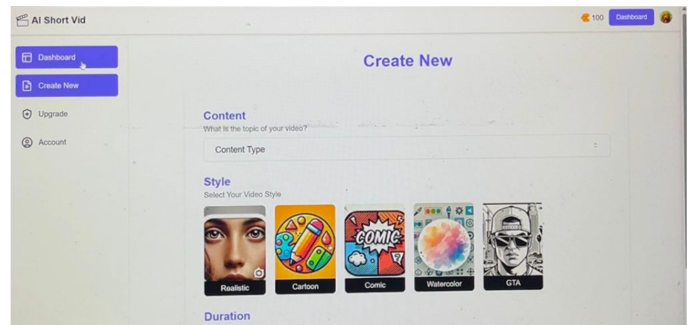
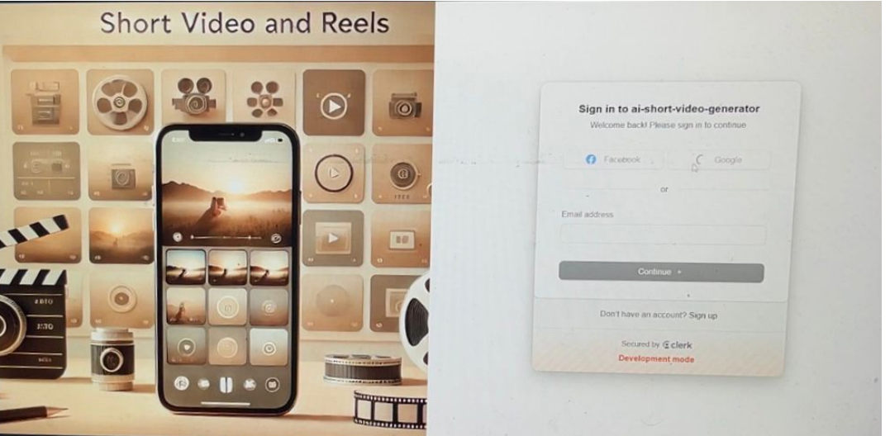
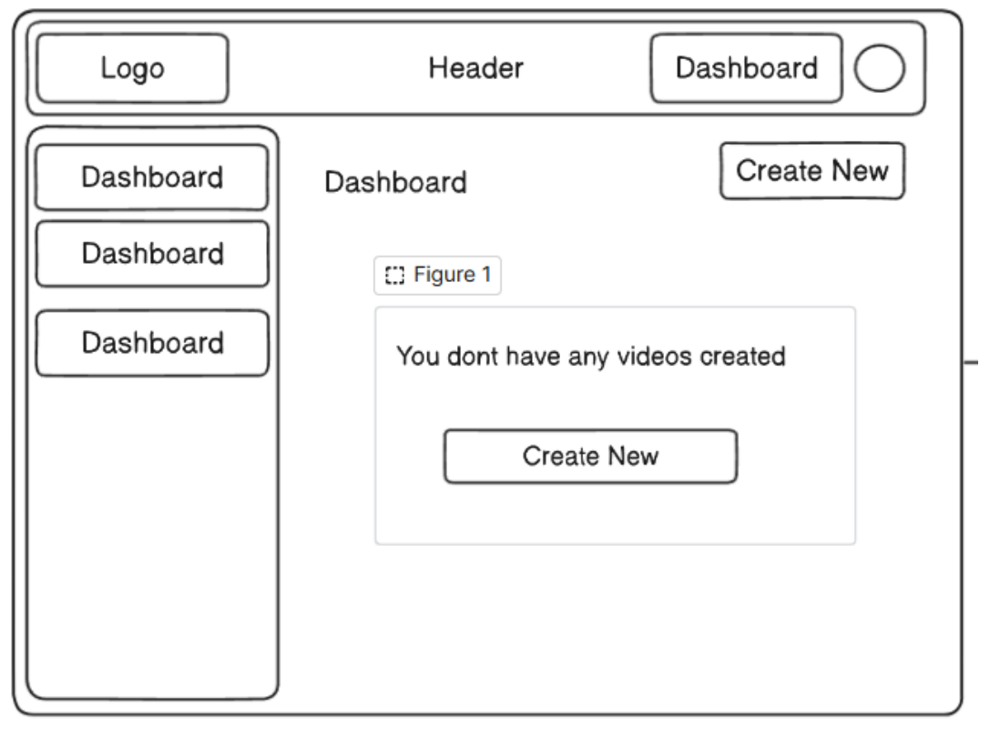
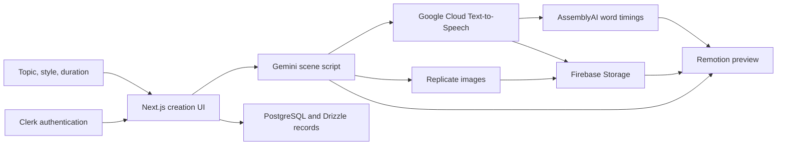

<div align="center">

# AI Short Video Generator

### From a topic to a narrated, captioned short-video preview.

**Full-stack prototype · November 2024 · No longer maintained**

[Prototype showcase](#prototype-showcase) · [How it worked](#how-it-worked) · [Architecture](#architecture) · [Run locally](#run-locally)

</div>



A prototype for bringing scriptwriting, image generation, narration, and captions into one creation workflow. Instead of assembling each asset manually, a user selected a topic, visual style, and duration, then moved through an AI-assisted pipeline to a Remotion video preview.

This repository preserves the original implementation. The screenshots below were recovered from the contemporary project report; they show the prototype as documented in 2024, rather than a newly deployed application.

## Prototype showcase

### 1. Sign in and enter the workspace

The sign-in screen paired a video-themed illustration with Clerk authentication. The application included sign-in and sign-up routes, a dashboard, and a separate creation page.



### 2. Choose the story and visual direction

The creation form combined content selection, visual style, and duration. The source includes **Realistic, Cartoon, Comic, Watercolor, and GTA** style options. Each choice fed the prompts used by the generation pipeline.

The opening screenshot shows the implemented creation screen. The early dashboard wireframe below captures the intended navigation and empty-state flow.



*Historical UI captures and an original wireframe, extracted from report figures. The screenshots retain their original photographic quality.*

### 3. Assemble the preview

The implementation connects scene scripts, generated images, narration, and word timings. Its Remotion component sequences images with zoom animation, overlays the current caption word, and plays the narration alongside the visuals.

| Stage | What the prototype source contains |
| --- | --- |
| Script | Gemini integration for scene text and image prompts |
| Images | Replicate integration using an SDXL Lightning model |
| Narration | Google Cloud Text-to-Speech API route |
| Captions | AssemblyAI transcription returning word timings |
| Composition | Remotion image sequences, zoom effects, captions, and audio |
| Persistence | Firebase Storage for media and PostgreSQL/Drizzle for records |

**Preserved evidence:** the archive contains the UI screenshots reproduced here, workflow diagrams, a report, a presentation, and a saved MP3 audio artifact. No standalone rendered video export was found. These materials document the historical prototype; the service integrations have not been rerun for this repository showcase.

## How it worked

1. **Select inputs:** choose content, style, and duration.
2. **Generate scenes:** request a structured script with narration text and image prompts.
3. **Create narration:** synthesize speech and store the audio in Firebase Storage.
4. **Time the captions:** transcribe the narration into word-level timestamps.
5. **Generate visuals:** create scene images through Replicate and store them in Firebase.
6. **Compose and preview:** combine the assets in a Remotion player and save project metadata.

## Architecture



*This diagram summarizes the prototype's data flow. It is not a deployment or security blueprint.*

## Technology

| Layer | Technologies |
| --- | --- |
| Interface | Next.js 14, React 18, Tailwind CSS, shadcn-style Radix UI components |
| Authentication | Clerk |
| API handlers | Next.js App Router route handlers |
| AI services | Gemini, Replicate, Google Cloud Text-to-Speech, AssemblyAI |
| Media composition | Remotion |
| Storage and records | Firebase Storage, Neon PostgreSQL, Drizzle ORM |

## Repository guide

```text
app/
  (auth)/                 Sign-in and sign-up pages
  api/                    Script, image, audio, and caption routes
  dashboard/              Workspace, creation form, and preview components
components/ui/            Shared interface components
configs/                  AI, database, schema, and Firebase configuration
remotion/                 Composition registration
public/                   Original interface assets
docs/showcase/           Historical screenshots and wireframe
```

## Run locally

The project is **no longer actively maintained**. Provider APIs, model identifiers, and dependencies may need updates before it runs today. The instructions below describe the source configuration; a fresh build and end-to-end generation have not been verified.

```bash
npm ci
```

Copy `.env.example` to `.env.local`, then supply your own service configuration. The example contains variable names only; real keys and the original environment file are excluded.

| Configuration | Purpose |
| --- | --- |
| Clerk keys and sign-in/sign-up URLs | Authentication; routes are `/sign-in` and `/sign-up` |
| Gemini and Google API credentials | Scene scripting and speech synthesis |
| `REPLICATE_API_TOKEN` | Image generation |
| `CAPTION_API` | AssemblyAI transcription |
| Firebase settings | Your own media storage project |
| Database URL | Your own Neon/PostgreSQL instance |

Replace the original Firebase project identifiers in `configs/FirebaseConfig.js`. Review the schema before running `npm run db:push`, which modifies the configured database.

**Before connecting a live database:** the archived source imports the database into client components and uses a public-prefixed database variable. Move database operations behind authenticated server APIs and keep database/provider secrets server-side. Further technical notes are in [PROJECT_NOTES.md](PROJECT_NOTES.md).

```bash
npm run dev
```

Open `http://localhost:3000`. Generation uses external services and may incur charges.

## What this prototype explored

- Orchestrating multiple AI services from a single creation form.
- Converting generated content into reusable audio, image, and caption assets.
- Synchronizing word timings with frame-based media composition.
- Bringing authentication, stored project records, and preview playback into a full-stack workflow.

The repository is retained as a historical project showcase, with the original code available for exploration.

